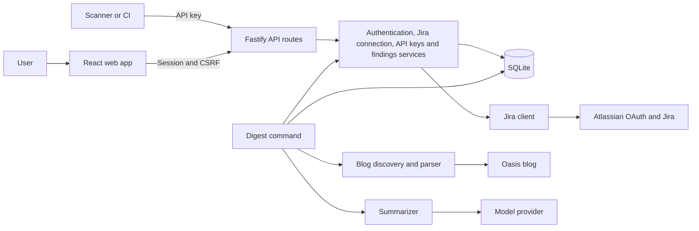
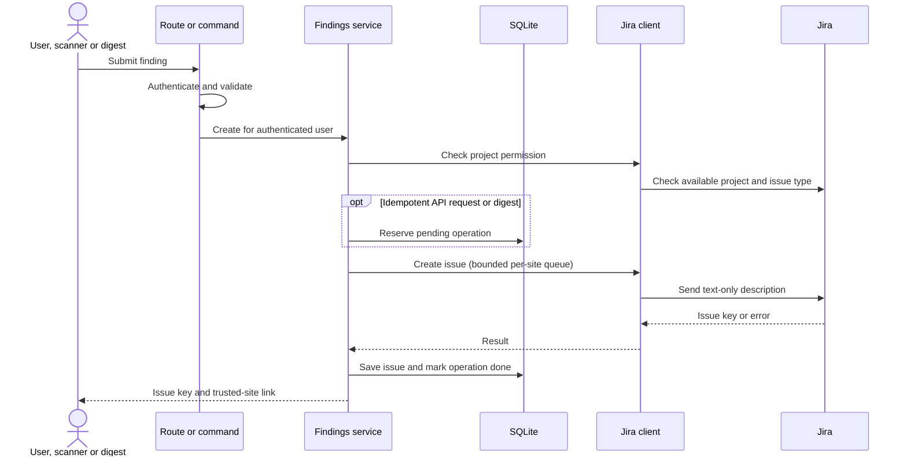

# IdentityHub system design

This diagram describes the planned end state. The current phase 1 changes implement the web account flow, authentication routes and service, and SQLite users and sessions; the Jira, findings, API key, and digest components remain planned.



- **Web and routes:** The browser holds no provider credentials. Routes authenticate, validate input, and map service errors to safe responses.
- **Services and database:** Services own business rules. User-owned records are always scoped to the authenticated identity. SQLite stores sessions, encrypted Jira credentials, hashed API keys, issue history, and duplicate-prevention state.
- **External boundaries:** Only the Jira client communicates with Atlassian; only the digest fetcher accesses the blog; only the AI adapter calls the model. Tests replace external services with fakes.
- **Shared creation path:** The web form, scanner API, and digest all use the findings service, which authorizes the project, creates safe Jira content, and records the result.

## Finding creation



If the remote outcome is uncertain, the operation remains blocked for human review; a local record alone cannot guarantee exactly-once Jira creation. A definite Jira success followed by a database failure returns the issue key and must not trigger another create.

## Trust boundaries

The current account flow stores hashed session IDs and uses session-bound CSRF tokens. In later phases, OAuth state will be bound to the initiating session and expire; Jira tokens will be encrypted at rest and API keys stored as hashes. The planned digest will treat blog and model output as untrusted, fetch only allowed hosts, supply article text as data to a tool-free model, validate the response, and avoid storing article text. Real provider behavior requires separate owner verification; automated tests will use fakes.

## Planned SQLite schema

This is the target schema: the users and sessions tables are implemented in the first migration, while the other tables remain planned. The migration file is authoritative for the current database. Timestamps are UTC ISO-8601 strings; IDs are opaque text values. Foreign keys must be enabled on every connection. Repositories must scope user-owned queries to the authenticated user even where a foreign key exists.

```sql
CREATE TABLE users (
  id TEXT PRIMARY KEY,
  email TEXT NOT NULL UNIQUE,
  password_hash TEXT NOT NULL,
  created_at TEXT NOT NULL
);

CREATE TABLE sessions (
  id_hash TEXT PRIMARY KEY,
  user_id TEXT NOT NULL REFERENCES users(id),
  csrf_token TEXT NOT NULL,
  created_at TEXT NOT NULL,
  expires_at TEXT NOT NULL
);

CREATE TABLE jira_connections (
  user_id TEXT PRIMARY KEY REFERENCES users(id),
  cloud_id TEXT NOT NULL,
  site_url TEXT NOT NULL,
  site_name TEXT NOT NULL,
  access_token_enc TEXT NOT NULL,
  refresh_token_enc TEXT NOT NULL,
  access_expires_at TEXT NOT NULL,
  scopes TEXT NOT NULL
);

CREATE TABLE oauth_states (
  state_hash TEXT PRIMARY KEY,
  user_id TEXT NOT NULL REFERENCES users(id),
  session_id_hash TEXT NOT NULL REFERENCES sessions(id_hash),
  expires_at TEXT NOT NULL,
  used_at TEXT
);

CREATE TABLE api_keys (
  id TEXT PRIMARY KEY,
  user_id TEXT NOT NULL REFERENCES users(id),
  name TEXT NOT NULL,
  key_prefix TEXT NOT NULL,
  key_hash TEXT NOT NULL UNIQUE,
  allowed_projects_json TEXT NOT NULL,
  created_at TEXT NOT NULL,
  last_used_at TEXT,
  revoked_at TEXT,
  UNIQUE (user_id, id)
);

CREATE TABLE created_issues (
  id TEXT PRIMARY KEY,
  user_id TEXT NOT NULL REFERENCES users(id),
  issue_key TEXT NOT NULL,
  issue_id TEXT NOT NULL,
  project_key TEXT NOT NULL,
  title TEXT NOT NULL,
  source TEXT NOT NULL,
  api_key_id TEXT,
  created_at TEXT NOT NULL,
  FOREIGN KEY (user_id, api_key_id) REFERENCES api_keys(user_id, id)
);
CREATE INDEX created_issues_recent
  ON created_issues(user_id, project_key, created_at DESC);

CREATE TABLE idempotency_keys (
  user_id TEXT NOT NULL REFERENCES users(id),
  key_hash TEXT NOT NULL,
  request_hash TEXT NOT NULL,
  status TEXT NOT NULL CHECK (status IN ('pending', 'done', 'unknown')),
  issue_key TEXT,
  created_at TEXT NOT NULL,
  PRIMARY KEY (user_id, key_hash)
);

-- Global metadata cache; never store article text here.
CREATE TABLE blog_posts (
  url TEXT PRIMARY KEY,
  title TEXT NOT NULL,
  date_published TEXT NOT NULL,
  fetched_at TEXT NOT NULL
);

CREATE TABLE digest_posts (
  user_id TEXT NOT NULL REFERENCES users(id),
  post_url TEXT NOT NULL,
  status TEXT NOT NULL CHECK (status IN ('pending', 'done', 'unknown')),
  issue_key TEXT,
  created_at TEXT NOT NULL,
  PRIMARY KEY (user_id, post_url)
);
```

The current application stores only hashes of session IDs. The planned API-key implementation will store key hashes, and the Jira implementation will encrypt tokens before persistence. OAuth state belongs to both a user and session; application checks must enforce that association and expiry. `pending` and `unknown` records prevent automatic repeat creation when the remote outcome is uncertain. For sitemap caching, migrations may add a last-modified or equivalent change marker after the actual sitemap behavior is verified. Retention and cleanup of expired sessions and OAuth states should be implemented without weakening replay protection.

## UI foundation

The signed-in shell uses a Radix dropdown for account actions and calls only the existing authentication API. The shell labels Jira functionality as unavailable; it does not contact Jira or introduce new server routes.

The current reporting view keeps draft text in component memory and does not send or persist it. The browser may suppress unload warnings. No findings API or Jira connection is implemented yet.

Session rechecks use the existing API. The signed-in workspace is keyed by user identity so a confirmed account change discards the previous user's in-memory draft. A transient check failure leaves it in place.
