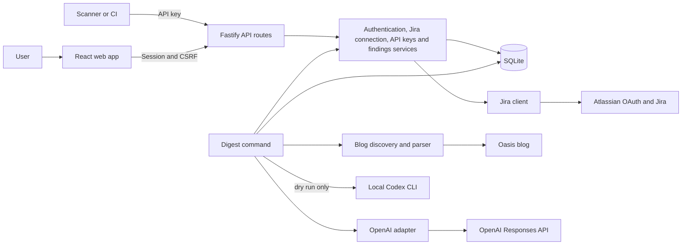
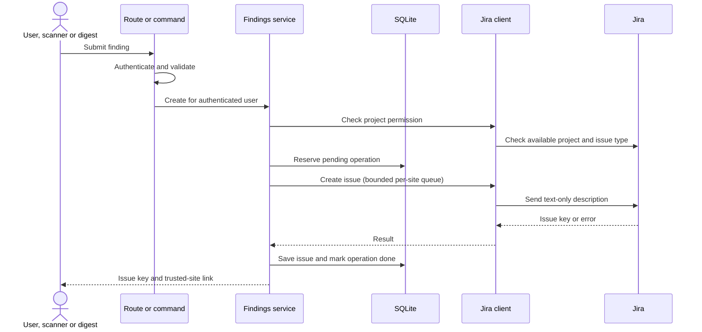

# IdentityHub system design

This document describes the implementation on this branch. For request paths and functions, see [code flow](CODE_FLOW.md); for configuration, see [onboarding](ONBOARDING.md). Verification status is recorded in the [changelog](../CHANGELOG.md).

- **Web and routes:** The browser holds no provider credentials. Routes authenticate, validate input, and map service errors to safe responses.
- **Services and database:** Services own business rules. User-owned records are always scoped to the authenticated identity. SQLite stores sessions, encrypted Jira credentials, hashed API keys, issue history, and duplicate-prevention state.
- **External boundaries:** Only the Jira client communicates with Atlassian; only the digest fetcher accesses the blog; only the AI adapter calls the model. Tests replace external services with fakes.
- **Shared creation path:** The web form, scanner API, and digest all use the findings service, which authorizes the project, creates safe Jira content, and records the result.

## Finding creation

If the remote outcome is uncertain, the operation remains blocked for human review; a local record alone cannot guarantee exactly-once Jira creation. A definite Jira success followed by a database failure returns the issue key and must not trigger another create.

## Trust boundaries

The standalone fake Atlassian service listens on loopback only and accepts a configured loopback callback. It uses public fixed test values, keeps no user data, and is not wired into the app. The browser test server separately injects a fake transport and runs isolated missing-configuration, invalid-key, and rejected-token-exchange scenarios; it does not use inherited Jira credentials. The existing Docker mock profile cannot expose its container-loopback listener and is not supported. Its limited protocol shapes follow [Atlassian's 3LO documentation](https://developer.atlassian.com/cloud/jira/platform/oauth-2-3lo-apps/); it does not enforce real OAuth replay protection.

The Jira boundary uses `jira.js` for authorization URLs and code exchange. The authenticated, CSRF-protected start route stores only a hash of a random state, bound to the user and session for ten minutes. The callback atomically consumes matching, unexpired state, exchanges the code, and stores encrypted tokens only if the initiating session remains valid. Session deletion removes its state. AES-256-GCM uses a random nonce and authenticates the user and token type; the 32-byte key is configured outside the database. Request logs omit query strings, and Jira responses use no-store and no-referrer. The token request is restricted to Atlassian's documented endpoint, rejects redirects, times out, and bounds response size. Tests use fake transports without network access. Refresh is single-flight per user in one server process; the database records an in-progress rotation before contacting Atlassian and requires reconnection after an uncertain outcome. Site selection and project discovery are scoped to the user. The status endpoint returns only configuration, saved connection state, and selected site for the authenticated session. The browser checks session identity around Jira requests and discards stale results. OAuth callback redirects use fixed local paths and do not include provider codes or state.

The current account flow stores hashed session IDs and uses session-bound CSRF tokens. Jira tokens are encrypted at rest; API key secrets are shown once and stored as SHA-256 hashes with a short prefix. Keys retain the selected site and an explicit allowlist of project keys and discovered project IDs; scanner authentication enforces the stored project IDs against fresh Jira discovery and rejects legacy records without IDs. The digest treats blog and model output as untrusted, fetches only allowed hosts, validates responses, and avoids storing article text. The OpenAI API adapter supplies article text to a tool-free model; the separate Codex CLI adapter is an agent and can access files permitted by its sandbox. Real provider behavior requires separate owner verification; automated tests use fakes.

## Current SQLite schema

The ordered SQL files in [`server/migrations/`](../server/migrations/) are authoritative. `openDatabase` enables foreign keys and applies unapplied migrations when the app or a digest command opens the database. The current tables are:

| Table | Purpose |
| --- | --- |
| `migrations` | Applied migration names. |
| `users`, `sessions` | Account password hashes and user-bound hashed session identifiers, CSRF tokens, and expiry. |
| `oauth_states`, `jira_credentials`, `jira_sites` | Session-bound OAuth state, encrypted rotating credentials and each user's selected Jira site. |
| `finding_operations`, `created_issues` | Idempotency and uncertain-outcome state, and locally recorded user/site/project issue history. |
| `api_keys` | Hashed API keys, owner, site, allowed project keys and IDs, and revocation metadata. |
| `digest_posts` | Per-user/post digest reservation and issue result; no article body. |

Blog metadata caching is in memory, not a SQLite table. User-owned reads and writes are scoped to the authenticated user or key owner. Pending and unknown states prevent blind repeats of uncertain remote writes. SQLite and in-process queues, rate limits, and refresh coordination assume a single server process.

## UI foundation

The signed-in shell uses a Radix dropdown for account actions. The browser calls only our authentication and Jira APIs; Jira requests remain behind the server boundary. Settings connects and selects a site, while Findings selects a discovered project.

The reporting view keeps draft text in component memory until submission. It sends a session-bound request with one idempotency key, prevents parallel submissions, and does not automatically retry. Unknown outcomes require checking Jira before another attempt. The browser may suppress unload warnings; drafts and acknowledgment are lost on reload. Finding writes and history reads include the browser’s expected site ID; the API rejects a changed site before returning history or issuing a write. The optional field preserves compatibility for older API callers, which instead use their currently selected site. Recent-ticket reads carry the session binding token, wait for refreshed connection status on focus, and render results only for the current project and site. Unrecognized write responses are treated as uncertain.

Session rechecks use the existing API. The signed-in workspace is keyed by user identity so a confirmed account change discards the previous user's in-memory draft. A transient check failure leaves it in place.

## Current Jira and finding boundaries

The Jira folder owns OAuth, site/project discovery and Jira SDK calls. The selected site is checked against the user's current accessible resources before use. Session writes require CSRF and a caller-provided idempotency key. Finding creation checks project access and Jira issue-type/field metadata, builds description text as ADF, serializes writes per site in a bounded in-memory queue, and records user-scoped issue history. A pending or unknown remote result is never automatically replayed. The queue and refresh coordination assume a single process; the database guard fails closed after interrupted rotation. An unexpired token rejected with 401 currently requires reconnection.

## Scanner authorization

The scanner route hashes the supplied key and resolves its owner and site from storage; it never accepts a caller-supplied user ID. It verifies the key allowlist against the current Jira project ID inside the shared per-site creation queue and rechecks key revocation and connection state immediately before reserving a write. Scanner idempotency keys are scoped to the API key, distinct from session operations. A pending or unknown operation cannot create another issue automatically. The rate limit is in-memory and per source IP, so a multi-process deployment needs a shared limiter. Only hashes of keys and idempotency identifiers are stored.

## Read-only blog discovery

The discovery command first checks Oasis robots.txt conservatively and uses its advertised sitemap. Any nonempty disallow or nonzero crawl delay in any group stops the crawl, as do a missing wildcard user-agent, a changed sitemap, or an unsupported directive. The discovery library also accepts an explicit sitemap URL and injected transport for fake-only tests. It permits only HTTPS `www.oasis.security` sitemap and blog URLs, rejects redirects and DTDs, limits sitemap and post counts and response sizes, and fails closed on incomplete traversal or ambiguous visible publication metadata. It returns the article URL, visible heading, publication date, and count of posts sharing the latest day. Because observed JSON-LD publication dates can reflect later updates, the visible “Published on” field is authoritative for this implementation. Within a day, URL order breaks ties rather than asserting a time. The optional bounded cache is in-memory and holds metadata, never article text; records with mismatched URLs or invalid titles or dates are ignored and refetched. Unchanged sitemap `lastmod` can permit stale metadata for up to one hour. The command starts with a fresh cache. Requests are serialized across calls in one process with a 500 ms gap; a timeout disables further discovery until process restart. Separate processes do not share this guard. The digest command now composes discovery, summarization, and the shared finding service.

### Summary preview

The preview reuses the discovery request queue and robots preflight to retrieve the selected URL, checks that the refetched article retains the selected title and publication date, extracts bounded text from one observed Oasis rich-text container, and passes it as untrusted input to a tool-free OpenAI Responses request with storage disabled. The endpoint is fixed, redirects are rejected, and response size, duration, and output are bounded. Only metadata and validated summary are returned; article text is not persisted. This selector was checked read-only against one live article and is tested using fake fixtures. Unchanged title and date do not prove unchanged article content. Prompt hierarchy does not guarantee factual accuracy or prevent all injection. ChatGPT plan OAuth is not implemented; the separate preview does not write to Jira.

### Digest execution

A local operator selects an existing account by configured email and a project key. The command captures the selected site at the start and passes it to the shared finding service, which rejects a site change before writing. It uses that account’s encrypted Jira connection. A per-user, per-post SQLite reservation is inserted before creation; done records prevent duplicates, while pending and unknown records block retry pending human review. A pending record older than 30 minutes is marked unknown on the next non-dry attempt. A confirmed Jira rejection or site mismatch before the write releases the reservation. This conservatively treats failures before the remote write as uncertain when their cause cannot be classified. Dry runs skip reservations and Jira writes, although database migrations can run. Fallback extracts bounded text, marks it degraded, and returns exit code 3; `--require-ai` fails instead. Only metadata and issue references are stored in the digest table.

The optional `--codex-cli` dry-run adapter starts a local ChatGPT-authenticated Codex process in a temporary directory with a read-only sandbox, ephemeral session, ignored user config, and a small environment allowlist excluding app secrets and API keys. It shares the API adapter's instructions and input/output bounds, applies process time and output limits, and rejects observed tool events. Codex is an agent and a sandbox is not equivalent to the API's `tools: []`: a tool could execute before its event is rejected, and a read-only sandbox may read accessible local files. The article is untrusted; use this local option only in a suitably isolated environment. No Jira write is possible through this digest option. The CLI model, retention and provider request differ from the API; CLI success does not verify API compatibility. See [Codex non-interactive mode](https://developers.openai.com/codex/noninteractive).
