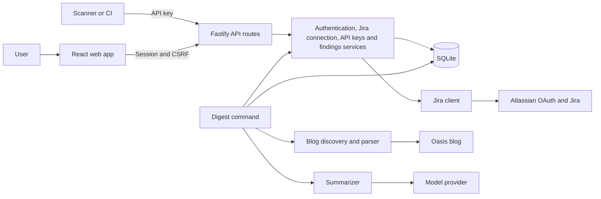
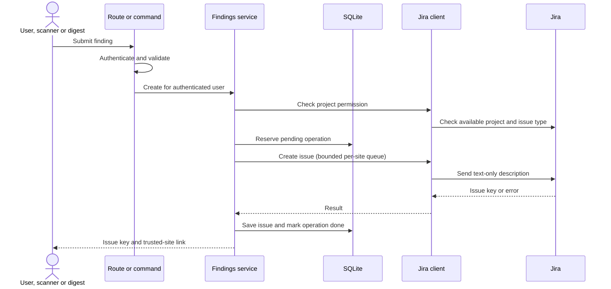

# IdentityHub system design

This diagram describes the planned end state. The current implementation includes the web account flow, authentication, session-bound Jira OAuth and encrypted credentials, site/project discovery, session-based finding creation and history, and a workspace shell with connection, site and project selection and local drafts; API key management and the finding UI are implemented; scanner authentication is implemented and the digest remains planned.



- **Web and routes:** The browser holds no provider credentials. Routes authenticate, validate input, and map service errors to safe responses.
- **Services and database:** Services own business rules. User-owned records are always scoped to the authenticated identity. SQLite stores sessions, encrypted Jira credentials, hashed API keys, issue history, and duplicate-prevention state.
- **External boundaries:** Only the Jira client communicates with Atlassian; only the digest fetcher accesses the blog; only the AI adapter calls the model. Tests replace external services with fakes.
- **Shared creation path:** The web form, scanner API, and digest all use the findings service, which authorizes the project, creates safe Jira content, and records the result.

## Finding creation



If the remote outcome is uncertain, the operation remains blocked for human review; a local record alone cannot guarantee exactly-once Jira creation. A definite Jira success followed by a database failure returns the issue key and must not trigger another create.

## Trust boundaries

The standalone fake Atlassian service listens on loopback only and accepts a configured loopback callback. It uses public fixed test values, keeps no user data, and is not wired into the app. The browser test server separately injects a fake transport and runs isolated missing-configuration, invalid-key, and rejected-token-exchange scenarios; it does not use inherited Jira credentials. The existing Docker mock profile cannot expose its container-loopback listener and is not supported. Its limited protocol shapes follow [Atlassian's 3LO documentation](https://developer.atlassian.com/cloud/jira/platform/oauth-2-3lo-apps/); it does not enforce real OAuth replay protection.

The Jira boundary uses `jira.js` for authorization URLs and code exchange. The authenticated, CSRF-protected start route stores only a hash of a random state, bound to the user and session for ten minutes. The callback atomically consumes matching, unexpired state, exchanges the code, and stores encrypted tokens only if the initiating session remains valid. Session deletion removes its state. AES-256-GCM uses a random nonce and authenticates the user and token type; the 32-byte key is configured outside the database. Request logs omit query strings, and Jira responses use no-store and no-referrer. The token request is restricted to Atlassian's documented endpoint, rejects redirects, times out, and bounds response size. Tests use fake transports without network access. Refresh is single-flight per user in one server process; the database records an in-progress rotation before contacting Atlassian and requires reconnection after an uncertain outcome. Site selection and project discovery are scoped to the user. The status endpoint returns only configuration, saved connection state, and selected site for the authenticated session. The browser checks session identity around Jira requests and discards stale results. OAuth callback redirects use fixed local paths and do not include provider codes or state.

The current account flow stores hashed session IDs and uses session-bound CSRF tokens. Jira tokens are encrypted at rest; API key secrets are shown once and stored as SHA-256 hashes with a short prefix. Keys retain the selected site and an explicit allowlist of project keys and discovered project IDs; scanner authentication enforces the stored project IDs against fresh Jira discovery and rejects legacy records without IDs. The planned digest will treat blog and model output as untrusted, fetch only allowed hosts, supply article text as data to a tool-free model, validate the response, and avoid storing article text. Real provider behavior requires separate owner verification; automated tests use fakes.

## Planned SQLite schema

This is an illustrative target schema; users, sessions, OAuth states, encrypted Jira credentials, selected sites, issue history and idempotency reservations are implemented in migrations. The current implementation separates credentials and selected sites instead of the illustrative `jira_connections` table below. Migration files are authoritative for the current database. Timestamps are UTC ISO-8601 strings; IDs are opaque text values. Foreign keys must be enabled on every connection. Repositories must scope user-owned queries to the authenticated user even where a foreign key exists.

```sql
CREATE TABLE users (
  id TEXT PRIMARY KEY,
  email TEXT NOT NULL UNIQUE,
  password_hash TEXT NOT NULL,
  created_at TEXT NOT NULL
);

CREATE TABLE sessions (
  id_hash TEXT PRIMARY KEY,
  user_id TEXT NOT NULL REFERENCES users(id),
  csrf_token TEXT NOT NULL,
  created_at TEXT NOT NULL,
  expires_at TEXT NOT NULL
);

CREATE TABLE jira_connections (
  user_id TEXT PRIMARY KEY REFERENCES users(id),
  cloud_id TEXT NOT NULL,
  site_url TEXT NOT NULL,
  site_name TEXT NOT NULL,
  access_token_enc TEXT NOT NULL,
  refresh_token_enc TEXT NOT NULL,
  access_expires_at TEXT NOT NULL,
  scopes TEXT NOT NULL
);

CREATE TABLE oauth_states (
  state_hash TEXT PRIMARY KEY,
  user_id TEXT NOT NULL REFERENCES users(id),
  session_id_hash TEXT NOT NULL REFERENCES sessions(id_hash),
  expires_at TEXT NOT NULL,
  used_at TEXT
);

CREATE TABLE api_keys (
  id TEXT PRIMARY KEY,
  user_id TEXT NOT NULL REFERENCES users(id),
  name TEXT NOT NULL,
  key_prefix TEXT NOT NULL,
  key_hash TEXT NOT NULL UNIQUE,
  site_id TEXT NOT NULL,
  allowed_projects_json TEXT NOT NULL,
  allowed_project_ids_json TEXT,
  created_at TEXT NOT NULL,
  last_used_at TEXT,
  revoked_at TEXT,
  UNIQUE (user_id, id)
);

CREATE TABLE created_issues (
  id TEXT PRIMARY KEY,
  user_id TEXT NOT NULL REFERENCES users(id),
  issue_key TEXT NOT NULL,
  issue_id TEXT NOT NULL,
  project_key TEXT NOT NULL,
  title TEXT NOT NULL,
  source TEXT NOT NULL,
  api_key_id TEXT,
  created_at TEXT NOT NULL,
  FOREIGN KEY (user_id, api_key_id) REFERENCES api_keys(user_id, id)
);
CREATE INDEX created_issues_recent
  ON created_issues(user_id, project_key, created_at DESC);

CREATE TABLE idempotency_keys (
  user_id TEXT NOT NULL REFERENCES users(id),
  key_hash TEXT NOT NULL,
  request_hash TEXT NOT NULL,
  status TEXT NOT NULL CHECK (status IN ('pending', 'done', 'unknown')),
  issue_key TEXT,
  created_at TEXT NOT NULL,
  PRIMARY KEY (user_id, key_hash)
);

-- Global metadata cache; never store article text here.
CREATE TABLE blog_posts (
  url TEXT PRIMARY KEY,
  title TEXT NOT NULL,
  date_published TEXT NOT NULL,
  fetched_at TEXT NOT NULL
);

CREATE TABLE digest_posts (
  user_id TEXT NOT NULL REFERENCES users(id),
  post_url TEXT NOT NULL,
  status TEXT NOT NULL CHECK (status IN ('pending', 'done', 'unknown')),
  issue_key TEXT,
  created_at TEXT NOT NULL,
  PRIMARY KEY (user_id, post_url)
);
```

The current application stores hashes of session IDs and encrypted Jira tokens in `jira_credentials`; the planned `jira_connections` table above describes the later site-discovery stage. The API-key management slice stores key hashes and site-bound project allowlists; the scanner authentication path is implemented. OAuth state belongs to both a user and session; application checks must enforce that association and expiry. `pending` and `unknown` records prevent automatic repeat creation when the remote outcome is uncertain. For sitemap caching, migrations may add a last-modified or equivalent change marker after the actual sitemap behavior is verified. Retention and cleanup of expired sessions and OAuth states should be implemented without weakening replay protection.

## UI foundation

The signed-in shell uses a Radix dropdown for account actions. The browser calls only our authentication and Jira APIs; Jira requests remain behind the server boundary. Settings connects and selects a site, while Findings selects a discovered project.

The reporting view keeps draft text in component memory until submission. It sends a session-bound request with one idempotency key, prevents parallel submissions, and does not automatically retry. Unknown outcomes require checking Jira before another attempt. The browser may suppress unload warnings; drafts and acknowledgment are lost on reload. Finding writes and history reads include the browser’s expected site ID; the API rejects a changed site before returning history or issuing a write. The optional field preserves compatibility for older API callers, which instead use their currently selected site. Recent-ticket reads carry the session binding token, wait for refreshed connection status on focus, and render results only for the current project and site. Unrecognized write responses are treated as uncertain.

Session rechecks use the existing API. The signed-in workspace is keyed by user identity so a confirmed account change discards the previous user's in-memory draft. A transient check failure leaves it in place.

## Current Jira and finding boundaries

The Jira folder owns OAuth, site/project discovery and Jira SDK calls. The selected site is checked against the user's current accessible resources before use. Session writes require CSRF and a caller-provided idempotency key. Finding creation checks project access and Jira issue-type/field metadata, builds description text as ADF, serializes writes per site in a bounded in-memory queue, and records user-scoped issue history. A pending or unknown remote result is never automatically replayed. The queue and refresh coordination assume a single process; the database guard fails closed after interrupted rotation. An unexpired token rejected with 401 currently requires reconnection.


## Scanner authorization

The scanner route hashes the supplied key and resolves its owner and site from storage; it never accepts a caller-supplied user ID. It verifies the key allowlist against the current Jira project ID inside the shared per-site creation queue and rechecks key revocation and connection state immediately before reserving a write. Scanner idempotency keys are scoped to the API key, distinct from session operations. A pending or unknown operation cannot create another issue automatically. The rate limit is in-memory and per source IP, so a multi-process deployment needs a shared limiter. Only hashes of keys and idempotency identifiers are stored.
